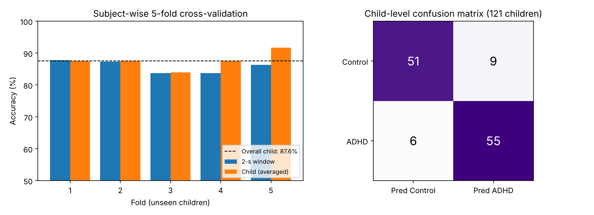

# 🧠 ADHD Diagnosis from EEG

**Can brain signals recorded while a child does an attention task help screen for ADHD?**

This repo takes two approaches to that question on the same dataset, and evaluates both the strict way: **every child is tested only by a model that never saw any of their data.**

| Approach | Idea | Child-level accuracy |
|---|---|---|
| **1. Deep learning: EEGNet + LSTM** ([`deep_learning/`](deep_learning)) | Learns patterns straight from the raw signal | **87.6%** (106 / 121 children) · recall 90.2% · ROC-AUC 0.93 |
| 2. Signal decomposition + Random Forest ([`helpers/`](helpers), [`rf_subject_level_outputs/`](rf_subject_level_outputs)) | Splits each channel into frequency modes, computes 41 entropy and statistical features per mode, keeps the best few | 75.2% (cross-validated, best 2-feature subset) |



## Dataset
[EEG data for ADHD / Control children](https://ieee-dataport.org/open-access/eeg-data-adhd-control-children) (Motie Nasrabadi et al., IEEE DataPort). **121 children aged 7–12** (61 ADHD, 60 controls), **19 electrodes** (10-20 system), 128 Hz. Recorded during a visual attention task: counting characters in pictures. The original `.mat` files are in [`archive/`](archive).

## Approach 1: EEGNet + LSTM
**Why this architecture:** EEGNet (Lawhern et al., 2018) is a compact CNN designed for EEG. Its first layer learns frequency filters, similar to the theta and beta bands clinicians look at. Its second layer learns which electrodes matter for each filter. We pass EEGNet's output over time to an **LSTM**, so the model also learns how activity changes across the 2-second window. The whole model has only **7,874 parameters**, which suits a dataset of 121 people.

**Pipeline**
1. Band-pass filter each recording at 1–45 Hz (removes slow drift and electrical noise), then normalise each channel per child.
2. Cut the recordings into 2-second windows with 50% overlap, giving **16,749 windows**.
3. Train with light augmentation (random amplitude scaling and noise).
4. To decide for a child, average the ADHD probability over all of that child's windows.

**Why subject-wise evaluation matters:** each child gives about 140 windows. If windows from the same child end up in both training and testing, the model can score highly by recognising the *child* instead of ADHD, and accuracy is inflated. This is a common flaw in published EEG results. Here, `StratifiedGroupKFold` keeps every child entirely inside one test fold.

**Results (5 folds, 25 epochs per fold, CPU)**
| Level | Accuracy | Precision | Recall | F1 | ROC-AUC |
|---|---|---|---|---|---|
| 2-second window | 85.8% | 0.865 | 0.883 | 0.874 | 0.919 |
| **Child** | **87.6%** | **0.859** | **0.902** | **0.880** | **0.927** |

Per-fold child accuracy: 87.5% · 87.5% · 84.0% · 87.5% · 91.7%. Of 61 children with ADHD, 55 were caught. 9 of 60 controls were flagged (false positives). Full output: [`deep_learning/results/`](deep_learning/results).

```bash
pip install torch scipy scikit-learn numpy
mkdir -p data && for z in archive/*_part*.zip; do unzip -q "$z" -d data/; done
cd deep_learning && python train.py --folds 5 --epochs 25     # about 35 min on a laptop CPU
```

## Approach 2: Signal decomposition + Random Forest
Each channel is split into intrinsic frequency modes with **EMD, EWT and VMD** (MATLAB helpers in [`helpers/matlab`](helpers/matlab)). For each mode, 41 features are computed: entropies (Shannon, Rényi, permutation, fuzzy…), moments, quartiles and Hjorth parameters ([`helpers/python/feature_extraction.py`](helpers/python/feature_extraction.py)). A Random Forest with recursive feature elimination then searches for the smallest feature set that still works. The best was **2 features, P7 (EWT mode 5) and Cz (EWT mode 2), at 75.2% cross-validated accuracy** ([`subset_search_channel_mode.csv`](rf_subject_level_outputs/subset_search_channel_mode.csv)). Parietal and central electrodes (P7, Pz, Cz) carried the most signal.

**What comparing the two shows:** hand-crafted features are easy to interpret (you can name the electrode and the frequency band), while the deep model is about 12 points more accurate. A real screening tool would probably need both: the accuracy, plus an explanation a clinician can check.

## Limitations
- 121 children from one hospital and one EEG device. Results need confirming on an outside dataset before any clinical claim.
- The ADHD group had been taking Ritalin, which may affect EEG.
- This is a **research screening aid, not a diagnostic tool.**

---
Built by **Madhvi Singh** · [LinkedIn](https://linkedin.com/in/madhvi-singh265)
